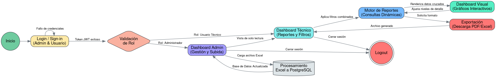

# EducaBoliviaHackatonMeca

**Sistema Web de Control Presupuestario y Ejecución Financiera**

---

## Introducción

**EducaBoliviaHackatonMeca** es una aplicación web interactiva desarrollada para gestionar, consolidar y analizar la ejecución presupuestaria y financiera. El sistema permite migrar información histórica y operativa proveniente de hojas de cálculo Excel hacia una base de datos relacional robusta, habilitando el seguimiento anual acumulado, reportes comparativos y la toma de decisiones mediante visualizaciones dinámicas.

---

## Contexto del Proyecto

### Objetivo
Construir un aplicativo web seguro e interactivo que permita administrar la carga de datos financieros y generar **7 reportes financieros** mediante consultas dinámicas, filtros combinados, visualización en dashboard y exportación en formatos **Excel** y **PDF**.

### Arquitectura y Seguridad
- **Modelo de Datos Relacional:** Migración desde archivos Excel hacia PostgreSQL con un esquema normalizado (Usuarios, Financiadores, Áreas, Rubros, Presupuestos y Movimientos) pensado para acumulación anual y alto rendimiento bajo consultas cruzadas.
- **Control de Acceso basado en Roles (JWT):**
  - **Administrador:** Encargado de la carga y actualización de archivos Excel hacia la base de datos, con acceso de solo lectura al panel técnico.
  - **Usuario Técnico:** Consumidor de reportes dinámicos con filtros combinados, análisis visual interactivo y exportación de archivos.
- **Trazabilidad y Rendimiento:** Incorporación de un registro de auditoría (*Audit Trail*) para rastrear cargas de datos y pruebas de estrés concurrentes (50–100 usuarios técnicos simultáneos).

### Pila Tecnológica
- **Backend:** Python, FastAPI, Pandas
- **Frontend:** Node.js, React / Next.js, librería de gráficos interactivos
- **Base de Datos:** PostgreSQL
- **Pruebas de Estrés:** Locust / k6

---

## Equipo y Fases de Desarrollo

| Integrante | Rol Principal |
| :--- | :--- |
| **Mateo** | Arquitectura de Base de Datos y PostgreSQL |
| **Marck** | Backend (Lógica de Negocios, Ingesta y API RESTful) |
| **Nat** | Frontend, Reportes y Dashboard Visual |
| **Miguel** | Integración, Pruebas de Estrés y Propuestas de Valor Único (UVPs) |

El desarrollo se organiza en 4 fases (24 horas):
1. **Fase 1 (Horas 1–6):** Estructura, autenticación JWT/roles y esquema SQL normalizado.
2. **Fase 2 (Horas 6–12):** Ingesta masiva de Excel con Pandas, consultas/índices para los 7 informes, interfaz de carga/filtros y *Audit Trail*.
3. **Fase 3 (Horas 12–18):** Renderizado de reportes y gráficos interactivos, exportación PDF/Excel y optimización con vistas materializadas si es necesario.
4. **Fase 4 (Horas 18–24):** Pruebas de estrés con Locust/k6, *connection pooling*, generación asíncrona y pulido UI/UX.

---

## Máquina de Estados

El flujo lógico del aplicativo —desde la autenticación obligatoria hasta la carga de datos, generación de reportes y cierre de sesión— se representa en el siguiente diagrama de estados (definido en [`diagram.gv`](./diagram.gv)):

### Descripción del Flujo
1. **Inicio y Autenticación (`Inicio` → `Login / Sign-in` → `Validación de Rol`):**
   - Ante un fallo de credenciales, el usuario permanece en `Login / Sign-in`.
   - Con un token JWT válido, se evalúa el rol del usuario.
2. **Rama de Administrador (`Dashboard Admin`):**
   - Permite cargar archivos Excel que pasan por **Procesamiento Excel a PostgreSQL**, actualizando la base de datos y retornando al panel de administración.
   - Permite acceder al `Dashboard Técnico` en vista de solo lectura.
3. **Rama de Usuario Técnico (`Dashboard Técnico`):**
   - Aplica filtros combinados hacia el **Motor de Reportes (Consultas Dinámicas)**.
   - Renderiza datos cruzados en el **Dashboard Visual (Gráficos Interactivos)**, desde donde es posible ajustar niveles de detalle de forma iterativa.
   - Permite solicitar formatos hacia **Exportación (Descarga PDF/Excel)**, devolviendo el archivo generado al panel técnico.
4. **Cierre de Sesión (`Logout`):**
   - Tanto desde `Dashboard Admin` como desde `Dashboard Técnico` se puede finalizar la sesión hacia `Logout`.

```dot
digraph Flujo_Financiero {
    rankdir=LR;
    node [fontname="Helvetica, Arial, sans-serif", shape=box, style="rounded,filled", fillcolor="#f8f9fa", color="#343a40"];
    edge [fontname="Helvetica, Arial, sans-serif", fontsize=10, color="#6c757d"];

    Inicio [shape=circle, fillcolor="#6fcb9f", label="Inicio"];
    Login [fillcolor="#ffeaa7", label="Login / Sign-in\n(Admin & Usuario)"];
    Validacion [shape=diamond, fillcolor="#fab1a0", label="Validación\nde Rol"];
    
    DashboardAdmin [fillcolor="#a29bfe", label="Dashboard Admin\n(Gestión y Subida)"];
    DashboardTecnico [fillcolor="#81ecec", label="Dashboard Técnico\n(Reportes y Filtros)"];
    
    Importacion [shape=cylinder, fillcolor="#dfe6e9", label="Procesamiento\nExcel a PostgreSQL"];
    MotorReportes [fillcolor="#74b9ff", label="Motor de Reportes\n(Consultas Dinámicas)"];
    Visualizacion [fillcolor="#55efc4", label="Dashboard Visual\n(Gráficos Interactivos)"];
    Exportacion [fillcolor="#ff7675", label="Exportación\n(Descarga PDF/Excel)"];
    
    Fin [shape=doublecircle, fillcolor="#ff7675", label="Logout"];

    Inicio -> Login;
    Login -> Login [label=" Fallo de credenciales"];
    Login -> Validacion [label=" Token JWT exitoso"];
    
    Validacion -> DashboardAdmin [label=" Rol: Administrador"];
    Validacion -> DashboardTecnico [label=" Rol: Usuario Técnico"];
    
    DashboardAdmin -> Importacion [label=" Carga archivo Excel"];
    Importacion -> DashboardAdmin [label=" Base de Datos Actualizada"];
    DashboardAdmin -> DashboardTecnico [label=" Vista de solo lectura"];
    
    DashboardTecnico -> MotorReportes [label=" Aplica filtros combinados"];
    MotorReportes -> Visualizacion [label=" Renderiza datos cruzados"];
    Visualizacion -> MotorReportes [label=" Ajusta niveles de detalle"];
    MotorReportes -> Exportacion [label=" Solicita formato"];
    Exportacion -> DashboardTecnico [label=" Archivo generado"];
    
    DashboardAdmin -> Fin [label=" Cerrar sesión"];
    DashboardTecnico -> Fin [label=" Cerrar sesión"];
}
```

Ver código fuente Graphviz (<code>diagram.gv</code>)

---

## Documentación Relacionada
- [`context.md`](./context.md) — Contexto general, pila tecnológica y zonas de estado por integrante.
- [`plan_de_implementacion.md`](./plan_de_implementacion.md) — Roles del equipo y plan detallado por fases.
- [`diagram.gv`](./diagram.gv) — Definición fuente del diagrama de flujo en Graphviz DOT.
