# Plan de Implementación: Sistema Web de Control Presupuestario

Este documento define la arquitectura, roles y fases de desarrollo para la Hackathon.

## ROLES DEL EQUIPO
*   **MATEO:** Arquitectura de Base de Datos y PostgreSQL.
*   **MARCK:** Backend (Lógica de Negocios y API).
*   **NAT:** Frontend, Reportes y Dashboard Visual.
*   **MIGUEL:** Integración, Pruebas de Estrés y Propuestas de Valor Único (UVPs).

## MÁQUINA DE ESTADOS (FLUJO DEL PROYECTO)
El siguiente código Graphviz (DOT) ilustra el flujo lógico del aplicativo, incluyendo la autenticación obligatoria para administradores y usuarios:

```dot
digraph Flujo_Financiero {
    rankdir=LR;
    node [fontname="Helvetica, Arial, sans-serif", shape=box, style="rounded,filled", fillcolor="#f8f9fa", color="#343a40"];
    edge [fontname="Helvetica, Arial, sans-serif", fontsize=10, color="#6c757d"];

    Inicio [shape=circle, fillcolor="#6fcb9f", label="Inicio"];
    Login [fillcolor="#ffeaa7", label="Login / Sign-in\n(Admin & Usuario)"];
    Validacion [shape=diamond, fillcolor="#fab1a0", label="Validación\nde Rol"];
    
    DashboardAdmin [fillcolor="#a29bfe", label="Dashboard Admin\n(Gestión y Subida)"];
    DashboardTecnico [fillcolor="#81ecec", label="Dashboard Técnico\n(Reportes y Filtros)"];
    
    Importacion [shape=cylinder, fillcolor="#dfe6e9", label="Procesamiento\nExcel a PostgreSQL"];
    MotorReportes [fillcolor="#74b9ff", label="Motor de Reportes\n(Consultas Dinámicas)"];
    Visualizacion [fillcolor="#55efc4", label="Dashboard Visual\n(Gráficos Interactivos)"];
    Exportacion [fillcolor="#ff7675", label="Exportación\n(Descarga PDF/Excel)"];
    
    Fin [shape=doublecircle, fillcolor="#ff7675", label="Logout"];

    Inicio -> Login;
    Login -> Login [label=" Fallo de credenciales"];
    Login -> Validacion [label=" Token JWT exitoso"];
    
    Validacion -> DashboardAdmin [label=" Rol: Administrador"];
    Validacion -> DashboardTecnico [label=" Rol: Usuario Técnico"];
    
    DashboardAdmin -> Importacion [label=" Carga archivo Excel"];
    Importacion -> DashboardAdmin [label=" Base de Datos Actualizada"];
    DashboardAdmin -> DashboardTecnico [label=" Vista de solo lectura"];
    
    DashboardTecnico -> MotorReportes [label=" Aplica filtros combinados"];
    MotorReportes -> Visualizacion [label=" Renderiza datos cruzados"];
    Visualizacion -> MotorReportes [label=" Ajusta niveles de detalle"];
    MotorReportes -> Exportacion [label=" Solicita formato"];
    Exportacion -> DashboardTecnico [label=" Archivo generado"];
    
    DashboardAdmin -> Fin [label=" Cerrar sesión"];
    DashboardTecnico -> Fin [label=" Cerrar sesión"];
}
```

## FASES DE IMPLEMENTACIÓN Y TAREAS

### Fase 1: Estructura, Seguridad y Base de Datos (Horas 1-6)
*   **Nat (Frontend):** Diseñar las vistas de *Login* y *Sign-in*. Implementar el enrutamiento protegido para diferenciar administradores de usuarios técnicos.
*   **Marck (Backend):** Configurar el servidor FastAPI. Construir los endpoints de autenticación utilizando JWT y cifrado de contraseñas.
*   **Mateo (Base de Datos):** Diseñar el esquema SQL (PostgreSQL). Crear tablas normalizadas para acumular información anual (Usuarios, Financiadores, Áreas, Rubros, Presupuestos, Movimientos).
*   **Miguel (Integración):** Configurar el repositorio, integrar el archivo `context.md` y verificar que el flujo de autenticación (Front -> Back -> DB) funcione correctamente.

### Fase 2: Ingesta de Datos y Core Lógico (Horas 6-12)
*   **Marck (Backend):** Desarrollar endpoint de carga Excel. Utilizar Pandas para limpiar y preparar la inserción masiva a la BD.
*   **Mateo (Base de Datos):** Escribir consultas SQL o vistas para los 7 informes requeridos. Estructurar índices para optimizar filtros cruzados.
*   **Nat (Frontend):** Construir la interfaz de carga (Dashboard Admin) y maquetar los selectores dinámicos del Dashboard Técnico.
*   **Miguel (UVPs):** Implementar un "Audit Trail" (Registro de Auditoría) en base de datos para rastrear quién sube archivos y cuándo.

### Fase 3: Visualización, Gráficos y Exportación (Horas 12-18)
*   **Nat (Frontend):** Consumir la API y renderizar los 7 reportes. Integrar librerías de gráficos interactivos y despliegue de detalles.
*   **Marck (Backend):** Programar la lógica de exportación. Generar archivos Excel con formato y PDFs basados en los filtros activos del usuario.
*   **Mateo (Base de Datos):** Monitorizar consultas de la API, crear Vistas Materializadas si los reportes consolidados presentan lentitud.
*   **Miguel (Integración):** Validar la consistencia de datos entre el Frontend (filtros) y el Backend (parámetros aceptados).

### Fase 4: Pruebas de Estrés y Pulido Final (Horas 18-24)
*   **Miguel (Pruebas de Estrés):** Simular 50-100 usuarios técnicos concurrentes con herramientas como `Locust` o `k6`. Probar generación simultánea de reportes y descargas.
*   **Mateo (Base de Datos):** Analizar impacto del estrés, ajustar Connection Pooling y optimizar cuellos de botella en PostgreSQL.
*   **Marck (Backend):** Refinar procesamiento. Implementar asincronismo en la generación de PDFs si el servidor se satura.
*   **Nat (Frontend):** Mejorar UI/UX, asegurar diseño responsivo y agregar feedback de carga (spinners) durante la exportación de archivos.